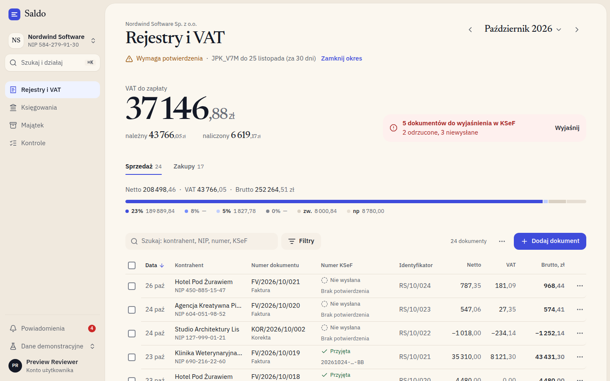
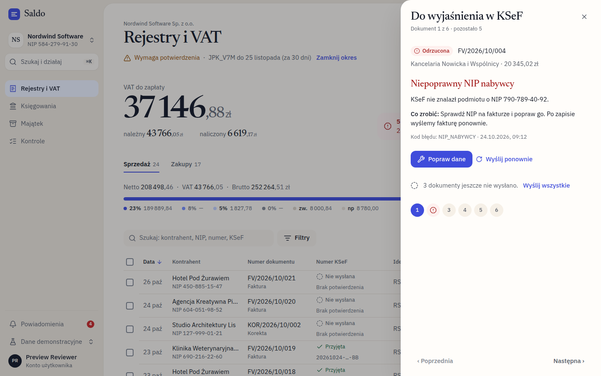
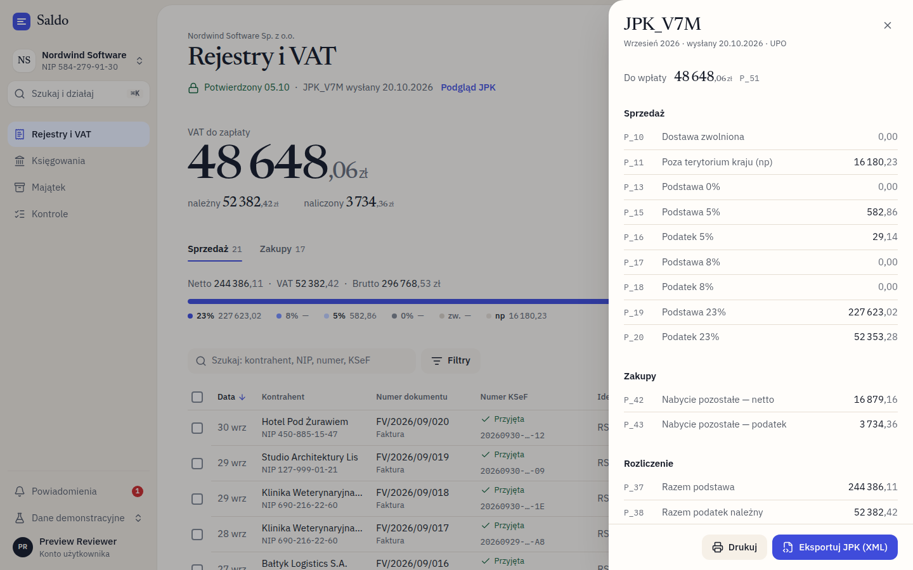
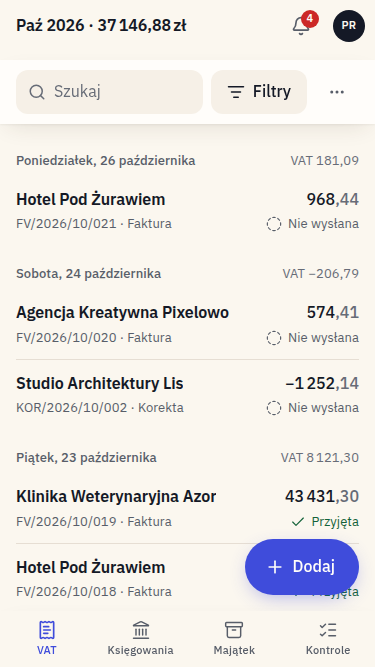
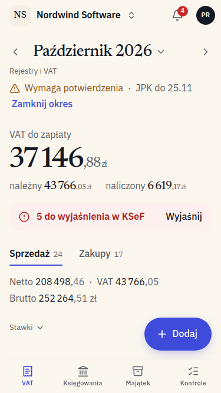

# Rejestry i VAT — redesign prototype ("Saldo", code name)

A clickable prototype of the "Rejestry i VAT" screen of an accounting SaaS used by an office that serves many client companies: VAT registers, KSeF e-invoices, period confirmation and JPK_V7M.



## Run
```bash
pnpm install
pnpm dev          # http://localhost:3000   (design system specimen: /design)
pnpm test         # NIP checksum, pl-PL amounts, VAT, dates
pnpm lint
pnpm build && pnpm start
```
Next.js 16 (App Router) · Tailwind 4 · Radix / shadcn primitives (restyled) · vaul · cmdk · TanStack Table · react-hook-form + zod.

## Demo
- **Demo state:** "Dane demonstracyjne" in the sidebar (on phones: the avatar menu), or `?state=filled|empty|error|loading`. Theme: user menu → Motyw, or `?theme=dark`.
- **Data:** everything goes through `src/lib/api.ts`, a fake async API with latency and an in-memory store, so a real backend replaces one file. The data is deterministic: 4 companies, January 2025 – December 2026, "today" fixed to 26.10.2026.
- **KSeF is simulated end to end:** send → *W kolejce* → *Przetwarzanie* → *Przyjęta* (number, UPO) or *Odrzucona* (code, reason, what to do).
  - A NIP or FA(3) rejection repeats until the offending field is corrected.
  - The newest unsent invoice hits an expired session; "Odnów połączenie" renews it and resends.
- **Locking:** a confirmed month is read-only, and the API refuses writes into it.
- **Keyboard:** `⌘K` search and act · `/` search · `N` new document · `↑/↓ Enter` rows and the detail panel · `Esc`.

## What was rethought, and why
1. **The period is the headline.** The original's Rok / Miesiąc selects, the "Wymaga potwierdzenia" badge and the yellow banner became one control and one line: `‹ Październik 2026 ›` with a month grid showing each month's JPK status, and "⚠ Wymaga potwierdzenia · JPK_V7M do 25 listopada · Zamknij okres".
2. **One number first.** The three equal Netto / VAT / Brutto tiles became **VAT do zapłaty** for the whole period, set large, with należny / naliczony under it. The register totals and the per-rate bars became one quiet line and one segmented bar that covers every rate, including zw and np.
3. **Problems come to you.** KSeF issues appear as one attention line ("5 dokumentów do wyjaśnienia"). It opens a triage sheet that shows one problem at a time: the reason in plain Polish, what to do, and "Popraw dane", which opens the form on the faulty field and resends on save.
4. **Progressive disclosure.** Only search, Filtry and Dodaj dokument are visible.
   - Filtry: Rodzaj operacji, Kod JPK V7, Serie dokumentów, Status KSeF and Stawka VAT, with live counts and removable chips.
   - ⋯: print, CSV, JPK preview, column visibility and order (the original's drag handles), "Oznacz kodami JPK", KSeF sync and refresh.
   - Row actions: the row ⋯ menu and the detail panel.
5. **Closing a month is a guided flow.** "Zamknij okres" goes *Sprawdź → Potwierdź → JPK* in one sheet. Rejected invoices block closing; unsent ones only warn. The JPK_V7M preview shows the P_ fields and exports XML; a confirmed month can be reopened (demo).
6. **Paper, not boxes.** The design system is "Papier i atrament": warm paper, cool ink, one ultramarine accent.
   - No borders or cards; space and type carry the structure.
   - Money is set like a ledger: Newsreader for amounts, IBM Plex for text, tabular figures, de-emphasised decimals.
   - Colour appears only where a decision is needed: healthy statuses are quiet text, problems are pills.
   - Light and dark themes come from the same semantic tokens.
7. **The phone is a first-class layout** (iPhone SE 375).
   - The period is the page title, and the top bar keeps "Paź 2026 · VAT" once you scroll.
   - A list grouped by day, with the day's VAT; long-press selects.
   - Every menu, sheet and form becomes a bottom drawer.
   - A FAB and a bottom nav. The layout also adapts smoothly in between: table columns drop by container width.
8. **Forms that help.**
   - NIP checksum (✓ when valid), pl-PL amounts and `dd.mm.rrrr` dates with its own calendar.
   - Live VAT and brutto, a hint when the date falls into another period, and a duplicate check with "Otwórz istniejący".
   - An error summary that links to the fields, and "Odrzucić zmiany?".
   - Delete is undoable.

States: filled, empty (register, future month), no results, error with retry, loading skeleton. Each one keeps the shell and period context visible.

## Documents
- `docs/inventory.md`: every field and action of the original (A1–A10, B1–B31) and where it lives now. Nothing was dropped; the only removal is the redundant subtitle (B3).
- `docs/REDESIGN-PLAN.md`: information architecture, wireframes, key scenarios, KSeF statuses and error copy.
- `docs/design-system.md`: tokens (tier 1 OKLCH primitives, tier 2 semantic, light and dark), type scale, spacing, motion, component recipes, considerations.
- `docs/design-principles.md`: principles from the "AI and Design Systems" course, with lesson references.
- `docs/screens/`: screenshots at 1440, 1920 and 375, light and dark, in every state.

| | |
|---|---|
|  |  |
|  |  |
